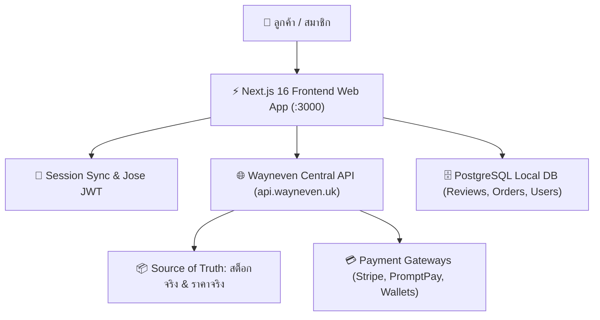
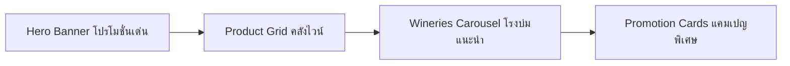
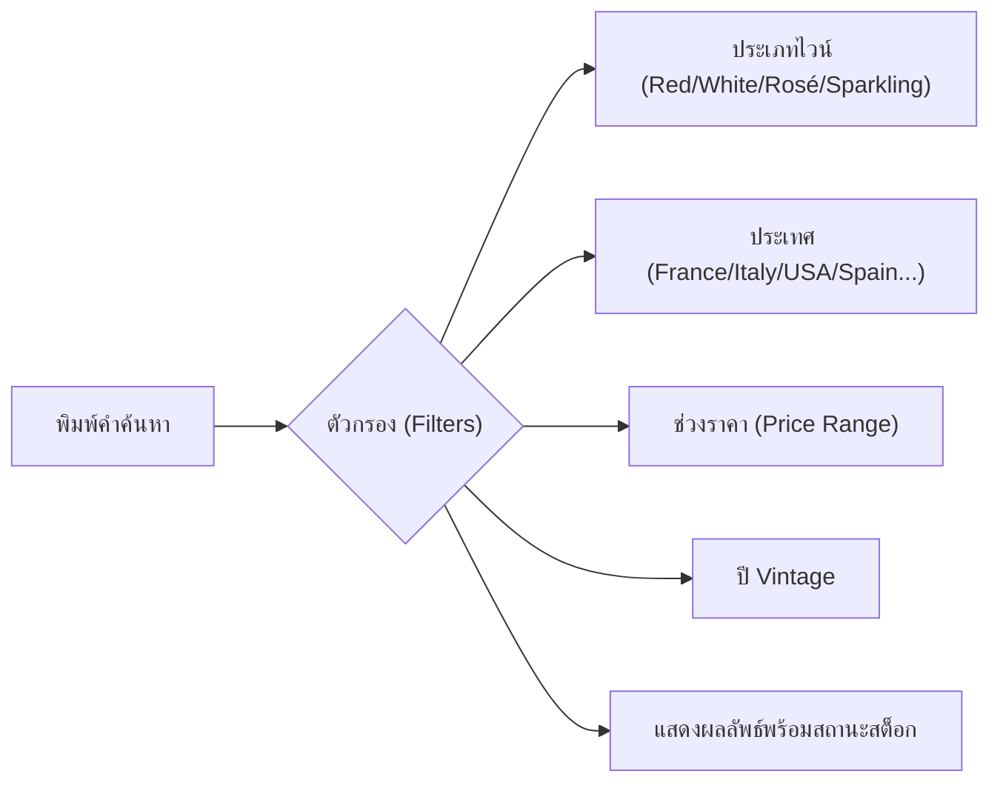
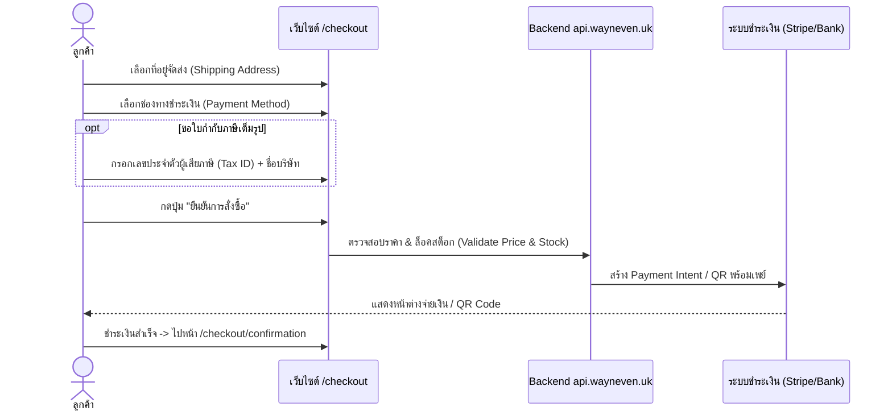

# 🍷 คู่มือการใช้งานระบบ The Bottle Club E-commerce & Wine Platform (ProjectbottleClub1)
> **เอกสารคู่มือปฏิบัติงานสำหรับพนักงานและทีมงาน (Staff & Operations Manual)**  
> โครงการร้านค้าออนไลน์และระบบสมาชิกไวน์ระดับพรีเมียม **The Bottle Club**

---

## 📋 สารบัญ (Table of Contents)
1. [ภาพรวมระบบและสถาปัตยกรรม (System Overview)](#1-ภาพรวมระบบและสถาปัตยกรรม)
2. [แผนผังหน้าจอทั้งหมดในระบบ (Site Map & Navigation)](#2-แผนผังหน้าจอทั้งหมดในระบบ)
3. [หน้าจอที่ 1: หน้าหลักและระบบแสดงสินค้า (`/`)](#3-หน้าจอที่-1-หน้าหลักและระบบแสดงสินค้า-)
4. [หน้าจอที่ 2: หน้ารายละเอียดสินค้าไวน์ (`/product/[id]`)](#4-หน้าจอที่-2-หน้ารายละเอียดสินค้าไวน์-productid)
5. [หน้าจอที่ 3: สารบบโรงกลั่นไวน์ระดับโลก (`/wineries` & `/wineries/[slug]`)](#5-หน้าจอที่-3-สารบบโรงกลั่นไวน์ระดับโลก-wineries)
6. [หน้าจอที่ 4: หน้าโปรโมชั่นและแคมเปญ (`/promotions`)](#6-หน้าจอที่-4-หน้าโปรโมชั่นและแคมเปญ-promotions)
7. [หน้าจอที่ 5: ค้นหาสินค้าขั้นสูง (`/search`)](#7-หน้าจอที่-5-ค้นหาสินค้าขั้นสูง-search)
8. [หน้าจอที่ 6: ระบบสแกนไวน์ด้วย AI (`/scan`)](#8-หน้าจอที่-6-ระบบสแกนไวน์ด้วย-ai-scan)
9. [หน้าจอที่ 7: ตะกร้าสินค้าและการคำนวณภาษี (`/cart`)](#9-หน้าจอที่-7-ตะกร้าสินค้าและการคำนวณภาษี-cart)
10. [หน้าจอที่ 8: การสั่งซื้อและชำระเงินออนไลน์ (`/checkout`)](#10-หน้าจอที่-8-การสั่งซื้อและชำระเงินออนไลน์-checkout)
11. [หน้าจอที่ 9: ตรวจสอบและยืนยันการชำระเงิน (`/confirm-payment`)](#11-หน้าจอที่-9-ตรวจสอบและยืนยันการชำระเงิน-confirm-payment)
12. [หน้าจอที่ 10: ติดตามสถานะการขนส่งพัสดุ (`/tracking`)](#12-หน้าจอที่-10-ติดตามสถานะการขนส่งพัสดุ-tracking)
13. [หน้าจอที่ 11: การจัดการบัญชีและระบบสมาชิก (`/account`)](#13-หน้าจอที่-11-การจัดการบัญชีและระบบสมาชิก-account)
14. [หน้าจอที่ 12: ระบบผู้ช่วย AI และการรองรับ 25+ ภาษา](#14-หน้าจอที่-12-ระบบผู้ช่วย-ai-และการรองรับ-25-ภาษา)
15. [คู่มือปฏิบัติงานสำหรับเจ้าหน้าที่แอดมินและฝ่ายบริการลูกค้า (Admin Operations)](#15-คู่มือปฏิบัติงานสำหรับเจ้าหน้าที่แอดมินและฝ่ายบริการลูกค้า)

---

## 1. ภาพรวมระบบและสถาปัตยกรรม

**The Bottle Club (ProjectbottleClub1)** คือระบบอีคอมเมิร์ซไวน์ระดับพรีเมียมที่ทำงานแบบ **Hybrid Architecture**:
* **Frontend App**: พัฒนาด้วย **Next.js 16 (App Router + Turbopack)** ร่วมกับ **React 19** และ **Tailwind CSS v4**
* **External Central Backend (`api.wayneven.uk`)**: ระบบแกนกลางที่ควบคุมราคาสินค้า, จำนวนสต็อก, การตัดสต็อก, การตรวจสอบคำสั่งซื้อ และระบบความปลอดภัย (Backend is the Security & Truth Authority)
* **Local Database (PostgreSQL)**: เก็บข้อมูลเสริม เช่น ประวัติการรีวิวสินค้า, ข้อมูลสำรองคำสั่งซื้อ และข้อมูลผู้ใช้
* **ระบบความปลอดภัยของสมาชิก (Members-Only Barrier)**: ไวน์ชั้นนำบางรายการจะซ่อนราคาและรายละเอียดเชิงลึกสำหรับผู้เยี่ยมชมทั่วไป (Guest) เพื่อกระตุ้นให้สมัครสมาชิกคลับ

---

## 2. แผนผังหน้าจอทั้งหมดในระบบ

| เส้นทาง (Route) | กลุ่มผู้ใช้ | หน้าที่หลัก |
| :--- | :--- | :--- |
| **`/`** | ทุกคน | หน้าแรก, แบนเนอร์โปรโมชั่นเด่น, สินค้าแนะนำ, ทางเข้าคลับ |
| **`/product/[id]`** | ทุกคน / สมาชิก | รายละเอียดไวน์, Tasting notes, รีวิว, สต็อก, สินค้าที่เกี่ยวข้อง |
| **`/wineries`** | ทุกคน | รายชื่อโรงบ่มไวน์ 80+ แห่งทั่วโลก และเรื่องราวของผู้ผลิต |
| **`/promotions`** | ทุกคน | โปรโมชั่นประจำเดือน, แคมเปญ Flash Sale, โค้ดส่วนลด |
| **`/search`** | ทุกคน | ค้นหาไวน์ตามชื่อ, สายพันธุ์องุ่น, ประเทศ, บอดี้, ช่วงราคา |
| **`/scan`** | ทุกคน | สแกนฉลากไวน์หรือบาร์โค้ดผ่านกล้องเพื่อตรวจข้อมูลด้วย AI |
| **`/cart`** | ทุกคน / สมาชิก | ตรวจสอบสินค้าในตะกร้า, คิด VAT 7%, แสดงแต้มสะสม |
| **`/checkout`** | สมาชิกที่ล็อกอิน | เลือกที่อยู่จัดส่ง, เลือกวิธีจ่ายเงิน, ขอใบกำกับภาษี |
| **`/checkout/confirmation/[id]`** | สมาชิก | หน้ายืนยันคำสั่งซื้อสำเร็จ พร้อมแสดงเลขอ้างอิงและคำแนะนำ |
| **`/confirm-payment/[id]`** | สมาชิก / ลูกค้า | อัปโหลดสลิปโอนเงิน / ยืนยันการชำระเงินผ่านระบบ |
| **`/tracking`** | ทุกคน | ค้นหาและดูแผนที่เส้นทางขนส่งพัสดุ (บก, เรือ, อากาศ) |
| **`/account/*`** | สมาชิกที่ล็อกอิน | จัดการโปรไฟล์, ที่อยู่, ประวัติคำสั่งซื้อ, แต้มสะสม, รีวิว |
| **`/login` & `/register`** | ผู้ใช้งานทั่วไป | เข้าสู่ระบบ และลงทะเบียนสมัครสมาชิก The Bottle Club |

---

## 3. หน้าจอที่ 1: หน้าหลักและระบบแสดงสินค้า (`/`)

หน้าแรกของเว็บไซต์ ทำหน้าที่เป็นหน้าร้านต้อนรับลูกค้าและนำเสนอคอลเลกชันไวน์ระดับโลก

### องค์ประกอบและฟังก์ชันการทำงาน:
1. **Hero Section:** แสดงแบนเนอร์ภาพยนตร์และแคมเปญเด่นประจำสัปดาห์ (Featured Promotion) พร้อมปุ่มสั่งซื้อด่วน
2. **Product Grid (คลังไวน์):**
   - แสดงการ์ดสินค้าไวน์ พร้อมระบุชนิด (Red Wine, White Wine, Rosé, Sparkling)
   - มีแท็กบอกแหล่งกำเนิด (เช่น Bordeaux France, Napa Valley USA, Rioja Spain)
3. **Members-Only Barrier (การจำกัดสิทธิ์เฉพาะสมาชิก):**
   - สำหรับผู้ใช้ทั่วไปที่ยังไม่ได้ล็อกอิน (Guest): ระบบจะแสดงตัวอย่างไวน์ แต่จะเบลอราคาหรือแจ้งให้สมัครสมาชิกก่อนเพื่อดูราคาพิเศษของคลับ
   - สำหรับสมาชิกที่ล็อกอินแล้ว: จะแสดงราคาจริง, ปุ่ม Quick Add to Cart, และแต้มสะสมที่จะได้รับทันที
4. **Wineries Carousel:** สไลด์แสดงโลโก้และชื่อโรงบ่มไวน์พาร์ทเนอร์ระดับตำนานจากทั่วโลก
5. **Promotion Section:** การ์ดโปรโมชั่นลดราคาพิเศษ กดเข้าไปดูรายละเอียดแคมเปญได้

---

## 4. หน้าจอที่ 2: หน้ารายละเอียดสินค้าไวน์ (`/product/[id]`)

หน้าแสดงข้อมูลเชิงลึกของไวน์แต่ละขวด เหมาะสำหรับนักสะสมและผู้ที่ต้องการทราบรายละเอียดก่อนตัดสินใจ

### รายละเอียดที่แสดงบนหน้าจอ:
1. **รูปภาพสินค้าความละเอียดสูง:** แสดงขวดไวน์ ป้ายฉลาก และรูปทรงขวด
2. **ข้อมูลจำเพาะ (Wine Specifications):**
   - **Winery:** โรงบ่มไวน์ผู้ผลิต
   - **Vintage:** ปีที่ผลิต (เช่น 2018, 2020)
   - **Grape Varieties:** สายพันธุ์องุ่น (เช่น Cabernet Sauvignon, Merlot, Pinot Noir, Chardonnay)
   - **Region & Country:** แคว้นและประเทศผู้ผลิต
   - **Alcohol by Volume (ABV):** เปอร์เซ็นต์แอลกอฮอล์ (เช่น 13.5%, 14.5%)
3. **Tasting Notes & Flavor Profile:**
   - กลิ่นอโรม่า (ผลไม้สีแดง, ไม้โอ๊ค, วานิลลา, แร่ธาตุ)
   - รสสัมผัส (Acidity ความเปรี้ยว, Tannin ความฝาด, Body ความหนักแน่น)
   - อาหารที่แนะนำให้ทานคู่กัน (Food Pairing Suggestions)
4. **การเลือกจำนวนและสั่งซื้อ:**
   - ตรวจสอบจำนวนสต็อกคงเหลือแบบ Real-time จาก Backend
   - ปุ่ม **"เพิ่มลงตะกร้า" (Add to Cart)** และปุ่ม **"ซื้อทันที" (Buy Now)**
5. **ส่วนรีวิวสินค้า (Customer Reviews):**
   - แสดงคะแนนดาวเฉลี่ย (1-5 ดาว)
   - ความคิดเห็นจริงจากสมาชิกที่เคยสั่งซื้อไวน์ขวดนี้
6. **สินค้าที่เกี่ยวข้อง (Related Wines Carousel):** แนะนำไวน์จากโรงกลั่นเดียวกัน หรือไวน์ในระดับราคาใกล้เคียงกัน

---

## 5. หน้าจอที่ 3: สารบบโรงกลั่นไวน์ระดับโลก (`/wineries` & `/wineries/[slug]`)

หน้าสารบัญที่รวบรวมโรงบ่มไวน์ชื่อดังระดับโลกกว่า **80+ แห่ง**

### ฟังก์ชันการทำงาน:
* **หน้าหลัก `/wineries`:**
  - รวบรวมรายชื่อโรงบ่มเรียงตามตัวอักษรและประเทศ (สเปน, อิตาลี, ฝรั่งเศส, สหรัฐอเมริกา, เยอรมนี, ออสเตรเลีย ฯลฯ)
  - มีช่องค้นหาชื่อโรงบ่มไวน์
* **หน้ารายโรงบ่ม `/wineries/[slug]`:**
  - ตัวอย่างเช่น `/wineries/tenuta-luce` หรือ `/wineries/armand-de-brignac`
  - แสดงเรื่องราว ประวัติความเป็นมา ภูมิศาสตร์ของไร่องุ่น เทคนิคการหมักบ่ม
  - แสดงแค็ตตาล็อกไวน์ทั้งหมดที่มีจำหน่ายของโรงบ่มแห่งนั้นโดยเฉพาะ

---

## 6. หน้าจอที่ 4: หน้าโปรโมชั่นและแคมเปญ (`/promotions`)

หน้ารวมสิทธิประโยชน์สำหรับสมาชิกและแคมเปญส่งเสริมการขาย

### ฟังก์ชันการทำงาน:
* แสดงรายการโปรโมชั่นทั้งหมดที่กำลังจัดรายการ (Active Promotions)
* รายละเอียดส่วนลด เช่น:
  - ส่วนลดต้อนรับสมาชิกใหม่ (Welcome Discount)
  - ซื้อไวน์พรีเมียม 2 ขวด รับส่วนลดพิเศษ
  - โปรโมชั่นจัดส่งฟรี (Free Shipping Campaign)
* ลูกค้าสามารถคลิกอ่านเงื่อนไข และกดดูรายการสินค้าที่ร่วมแคมเปญได้ทันที

---

## 7. หน้าจอที่ 5: ค้นหาสินค้าขั้นสูง (`/search`)

เครื่องมือช่วยให้ลูกค้าและพนักงานค้นหาไวน์ได้อย่างรวดเร็วและแม่นยำ

### ตัวกรองที่มีให้ใช้งาน (Filter Options):
1. **Search Input:** พิมพ์ชื่อไวน์, สายพันธุ์องุ่น, หรือชื่อผู้ผลิต
2. **Category:** กรองประเภทไวน์ (Red, White, Rosé, Sparkling, Dessert Wine)
3. **Country / Region:** เลือกประเทศและเขตผลิต
4. **Price Slider:** เลื่อนกำหนดช่วงราคาต่ำสุด - สูงสุด
5. **Sort Options:** จัดเรียงตาม ราคาต่ำไปสูง, ราคาสูงไปต่ำ, สินค้ามาใหม่, หรือสินค้ายอดนิยม

---

## 8. หน้าจอที่ 6: ระบบสแกนไวน์ด้วย AI (`/scan`)

สุดยอดฟีเจอร์นวัตกรรม **AI Wine Scanner** ช่วยให้ลูกค้าและพนักงานหน้าร้านค้นหาข้อมูลไวน์ได้เพียงแค่ใช้กล้อง

### วิธีการใช้งาน:
1. เปิดหน้า `/scan` บนสมาร์ทโฟนหรืออุปกรณ์ที่มีกล้อง
2. เล็งกล้องไปที่ **ฉลากด้านหน้าขวดไวน์** หรือ **บาร์โค้ด**
3. ระบบ AI จะทำการสแกนรูปภาพและเปรียบเทียบกับฐานข้อมูลไวน์ระดับโลก
4. **ผลลัพธ์ที่ได้ทันที:**
   - ระบุชื่อรุ่นและปีที่ผลิตอย่างแม่นยำ
   - ดึงข้อมูล Tasting notes, คำแนะนำในการเสิร์ฟ, และอุณหภูมิที่เหมาะสม
   - ตรวจสอบว่ามีจำหน่ายในสต็อกของ The Bottle Club หรือไม่ พร้อมปุ่มกดสั่งซื้อทันที

---

## 9. หน้าจอที่ 7: ตะกร้าสินค้าและการคำนวณภาษี (`/cart`)

หน้าจอตรวจสอบรายการสินค้าก่อนเข้าสู่กระบวนการชำระเงิน

### รายละเอียดการคำนวณและฟังก์ชัน:
* **ปรับจำนวนสินค้า:** กดปุ่ม `+` หรือ `-` หรือกดลบรายการที่ไม่ต้องการ
* **คำนวณภาษีมูลค่าเพิ่ม (VAT 7%):** แยกแสดงยอดก่อนภาษีและภาษีมูลค่าเพิ่ม 7% อย่างถูกต้องตามกฎหมาย
* **แสดงแต้มสะสมที่จะได้รับ:** คำนวณแต้ม Reward Points ที่ลูกค้าจะได้รับจากคำสั่งซื้อนี้โดยอัตโนมัติ
* **ระบบบันทึกตะกร้าข้ามอุปกรณ์ (State Sync):** ตะกร้าสินค้าจะถูกบันทึกไว้ในระบบ หากลูกค้าสลับเครื่องหรือเผลอปิดหน้าจอ ข้อมูลสินค้าในตะกร้าจะไม่สูญหาย
* **ปุ่มเข้าสู่การชำระเงิน (Proceed to Checkout):** หากยังไม่ได้ล็อกอิน ระบบจะพาลูกค้าไปหน้าเข้าสู่ระบบก่อน

---

## 10. หน้าจอที่ 8: การสั่งซื้อและชำระเงินออนไลน์ (`/checkout`)

หน้าจอสำคัญสำหรับการสรุปคำสั่งซื้อ เลือกที่อยู่จัดส่ง และเลือกช่องทางชำระเงิน

### ขั้นตอนในหน้า Checkout:
1. **เลือกที่อยู่จัดส่ง (Shipping Address):**
   - สามารถเลือกที่อยู่ที่เคยบันทึกไว้ หรือกด "เพิ่มที่อยู่ใหม่"
2. **การขอใบกำกับภาษีเต็มรูปแบบ (Full Tax Invoice):**
   - ติ๊กถูกที่ช่อง **"ต้องการใบกำกับภาษีเต็มรูปแบบ"**
   - กรอก **เลขประจำตัวผู้เสียภาษี (TAX ID 13 หลัก)**, **ชื่อนิติบุคคล/บุคคลธรรมดา**, และที่อยู่ออกใบกำกับ
3. **ช่องทางการชำระเงินที่รองรับ (Payment Options):**
   - 💳 **บัตรเครดิต / บัตรเดบิต (Stripe):** ชำระผ่านระบบความปลอดภัยสากล PCI-DSS
   - 📱 **QR Code พร้อมเพย์ (PromptPay):** สแกนจ่ายผ่าน Mobile Banking ทุกธนาคาร
   - 🏦 **โอนเงินผ่านบัญชีธนาคาร (Bank Transfer):** โอนเข้าบัญชีบริษัทพร้อมแนบสลิป
   - 💵 **เก็บเงินปลายทาง (Cash on Delivery):** ชำระเงินสดเมื่อได้รับสินค้า
   - 🛍️ **E-Wallets:** รองรับ TrueMoney Wallet, ShopeePay, Rabbit LINE Pay, Alipay, และ WeChat Pay
4. **กดยืนยันการสั่งซื้อ:** ระบบจะสร้าง Order ID และพาไปสู่หน้ายืนยันคำสั่งซื้อ

---

## 11. หน้าจอที่ 9: ตรวจสอบและยืนยันการชำระเงิน (`/confirm-payment`)

ใช้สำหรับกรณีที่ลูกค้าเลือกชำระเงินแบบโอนผ่านบัญชีธนาคาร แล้วต้องการส่งหลักฐานสลิป

### การทำงาน:
* เข้าผ่านลิงก์ `/confirm-payment/[orderId]` (หรือกดจากประวัติคำสั่งซื้อ)
* แสดงสรุปยอดเงินที่ต้องชำระ และข้อมูลบัญชีธนาคารของบริษัท
* ลูกค้าทำการ **อัปโหลดภาพสลิปการโอนเงิน (Payment Slip)**
* เมื่อกดยืนยัน ข้อมูลสลิปจะถูกส่งต่อไปยังระบบตรวจสอบของแอดมินหลังบ้านทันที

---

## 12. หน้าจอที่ 10: ติดตามสถานะการขนส่งพัสดุ (`/tracking`)

ระบบติดตามการจัดส่งพัสดุแบบ Multi-Modal Tracking รองรับทั้งการจัดส่งในประเทศและการนำเข้าระหว่างประเทศ

### คุณสมบัติเด่น:
1. **ค้นหาตามเลขพัสดุ (Tracking Number):** หรือค้นหาผ่านหมายเลขคำสั่งซื้อ
2. **แผนที่การขนส่งแบบโต้ตอบ (Interactive Leaflet Map):**
   - แสดงหมุดและเส้นทางการเดินทางของไวน์จากต้นทางจนถึงมือผู้รับ
3. **รองรับรูปแบบการขนส่ง 3 รูปแบบ:**
   - 🚚 **DOM (Domestic Express):** จัดส่งด่วนควบคุมอุณหภูมิภายในประเทศ
   - ✈️ **AIR (Air Cargo):** ขนส่งด่วนทางอากาศสำหรับไวน์นำเข้าพิเศษ
   - 🚢 **SEA (Sea Freight):** ขนส่งทางเรือตู้ควบคุมอุณหภูมิ (Reefer Container)
4. **ลำดับสถานะการจัดส่ง:**
   - `Order Placed` ➔ `Confirmed` ➔ `Packing` ➔ `In Transit` ➔ `Out for Delivery` ➔ `Delivered`

---

## 13. หน้าจอที่ 11: การจัดการบัญชีและระบบสมาชิก (`/account`)

ศูนย์รวมข้อมูลส่วนตัวและสิทธิประโยชน์ของสมาชิก The Bottle Club

### เมนูย่อยในระบบ Account:
* **`/account/profile` (ข้อมูลส่วนตัว):** แก้ไขชื่อ-นามสกุล, เบอร์โทรศัพท์, อีเมลติดต่อ, และเปลี่ยนรหัสผ่าน
* **`/account/orders` (ประวัติคำสั่งซื้อ):**
  - ดูรายการออเดอร์ทั้งหมดในอดีต
  - ตรวจสอบสถานะการจ่ายเงิน, เลข Tracking พัสดุ
  - ปุ่มสั่งซื้อซ้ำ (Re-order)
* **`/account/addresses` (สมุดที่อยู่):** บันทึกที่อยู่จัดส่งประจำ เช่น ที่บ้าน, ที่ทำงาน, หรือคลังส่วนตัว
* **`/account/points` (คะแนนสะสม):** ดูคะแนน Reward Points คงเหลือ และประวัติการได้รับคะแนนจากการซื้อ
* **`/account/reviews` (รีวิวของฉัน):** ตรวจสอบประวัติการเขียนรีวิวไวน์ที่ลูกค้าเคยให้คะแนนไว้
* **`/account/privacy` (ความเป็นส่วนตัว):** จัดการสิทธิ์ความยินยอมตาม พ.ร.บ. คุ้มครองข้อมูลส่วนบุคคล (PDPA)

---

## 14. หน้าจอที่ 12: ระบบผู้ช่วย AI และการรองรับ 25+ ภาษา

ระบบพิเศษที่ช่วยอำนวยความสะดวกให้ลูกค้าทั่วโลก:

### 1. ผู้ช่วยเสมือนจริง AIChat (Floating AI Sommelier)
* ไอคอนปุ่มแชทลอยอยู่ที่มุมขวาล่างของทุกหน้า
* ลูกค้าสามารถสอบถาม:
  - *"อยากได้ไวน์แดงสำหรับทานคู่กับสเต็กเนื้อวากิว งบไม่เกิน 3,000 บาท"*
  - *"ไวน์ตัวนี้ต้องเสิร์ฟที่อุณหภูมิกี่องศา"*
  - *"แนะนำไวน์ขาวรสชาติสดชื่นสำหรับงานปาร์ตี้ริมสระ"*
* AI จะค้นหาและส่งลิงก์ไวน์ที่ตรงกับความต้องการให้ลูกค้ากดซื้อได้ทันที

### 2. ผู้ช่วยเสียง (VoiceAssistant)
* ลูกค้าสามารถกดปุ่มไมโครโฟนเพื่อพูดค้นหาสินค้า เช่น *"ค้นหาไวน์จากฝรั่งเศส"* ระบบจะนำทางไปยังหน้าผลลัพธ์โดยไม่ต้องพิมพ์

### 3. ระบบหลายภาษา (25+ Languages & RTL Support)
* รองรับภาษาสำคัญทั่วโลก: ไทย, อังกฤษ, ฝรั่งเศส, จีน, ญี่ปุ่น, สเปน, เยอรมัน, อิตาลี ฯลฯ
* รองรับภาษาที่อ่านจากขวาไปซ้าย (RTL) เช่น ภาษาอาหรับ (Arabic) และฮีบรู (Hebrew)

---

## 15. คู่มือปฏิบัติงานสำหรับเจ้าหน้าที่แอดมินและฝ่ายบริการลูกค้า

สำหรับพนักงานที่ต้องดูแลลูกค้า ตรวจสอบคำสั่งซื้อ และจัดการระบบ:

### 1. การตรวจสอบและยืนยันออเดอร์ (Order Verification)
1. เมื่อลูกค้าทำการสั่งซื้อ ออเดอร์จะเข้าสู่ระบบสถานะ `pending`
2. หากเป็นการชำระผ่าน **Stripe หรือ PromptPay Dynamic:** ระบบจะตัดเงินและอัปเดตเป็น `confirmed` ให้อัตโนมัติ
3. หากเป็นการชำระแบบ **โอนเงินผ่านบัญชี:**
   - เจ้าหน้าที่เปิดดูสลิปที่ลูกค้าแนบมาในหน้าคำสั่งซื้อ
   - ตรวจสอบยอดเงิน วันที่ และเวลาโอนในบัญชีธนาคารของบริษัท
   - หากยอดถูกต้อง ให้เปลี่ยนสถานะออเดอร์เป็น `confirmed`
   - หากยอดไม่ถูกต้อง ให้ติดต่อลูกค้าหรือเปลี่ยนสถานะเป็น `payment_rejected`

### 2. การจัดการขนส่งและพัสดุ (Shipping & Fulfillment)
1. เมื่อแพ็กสินค้าเรียบร้อยแล้ว ให้อัปเดตสถานะเป็น `shipped`
2. บันทึก **Tracking Number** ลงในระบบ
3. ระบบจะส่งอีเมลแจ้งเตือนลูกค้าพร้อมลิงก์สำหรับเปิดดูหน้า `/tracking` ทันที

### 3. การออกใบกำกับภาษี (Tax Invoice Management)
* ตรวจสอบออเดอร์ที่มีการขอใบกำกับภาษี (`is_full_tax_invoice = true`)
* นำข้อมูล `tax_id`, `tax_business_name`, และ `tax_address` ไปออกใบกำกับภาษีอิเล็กทรอนิกส์ (e-Tax Invoice) หรือพิมพ์แนบไปพร้อมกับกล่องสินค้า

### 4. การจัดการรีวิวสินค้า (Review Moderation)
* รีวิวที่ลูกค้าส่งเข้ามาจะผ่านการตรวจสอบเพื่อป้องกันข้อความสแปมหรือถ้อยคำที่ไม่สุภาพ ก่อนที่จะแสดงผลบนหน้าสินค้าสาธารณะ

---
*จัดทำขึ้นเพื่อให้ทีมงานและพนักงานทุกคนของ The Bottle Club สามารถดำเนินงาน สนับสนุนลูกค้า และให้บริการได้อย่างเป็นมืออาชีพ*
